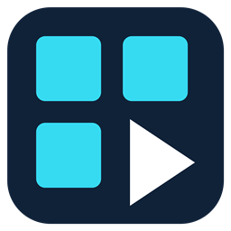

<p align="center">
  
</p>

<h1 align="center">QuadDeck</h1>

<p align="center">
  <strong>Five videos. One window. Your timeline.</strong><br>
  A native Windows player with synchronised or independent playback,<br>
  hardware acceleration, Emby integration and styled subtitles.
</p>

<p align="center">
  <a href="https://github.com/maddoxhuang/Quaddeck/actions/workflows/windows-build.yml"></a>
  <a href="CHANGELOG.md#120-2026-10-15"></a>
  <a href="#upgrading-and-building"></a>
  <a href="CMakeLists.txt"></a>
  <a href="LICENSE"></a>
</p>

<p align="center">
  <a href="#get-started">Get started</a> ·
  <a href="#feature-overview">Features</a> ·
  <a href="#keyboard-shortcuts">Shortcuts</a> ·
  <a href="CHANGELOG.md">Changelog</a> ·
  <a href="https://github.com/maddoxhuang/Quaddeck/issues">Report an issue</a>
</p>

---

## Feature overview

| | What you can do |
| :--- | :--- |
| **Five video panes** | Watch up to five videos in one window, choose a layout and drag panes to rearrange them. |
| **Flexible playback** | Keep videos in sync, adjust their timing with offsets or seek through each one independently. |
| **Audio per pane** | Mix audio from several videos, with separate volume, mute and track controls. |
| **Local files and Emby** | Browse folders or your Emby library and give each pane its own playback queue. |
| **Styled subtitles** | Display ASS / SSA subtitles with their styling and attached fonts, or load SRT / WebVTT files. |
| **GPU decoding and shaders** | Use hardware decoding, adjust Vibrance+ and enable RTX Video features on supported systems. |

**New in v1.2.0:** compact playback controls and pane-edge seek bars, an Emby sign-in form inside the sheet, cast and person pages, a subtitle switch, and an empty-window Emby shortcut. See the [changelog](CHANGELOG.md#120-2026-10-15) for all changes.

<details>
<summary><strong>More features</strong></summary>

- **Playback controls:** shared and independent timelines, per-video offsets, playback speed, repeat and A-B loops. Exact synchronised seeking is used when starting or restarting a group.
- **Layouts:** six arrangements adapt to the videos you open. Focus on one pane with Solo, choose a larger main pane, and adjust each video's zoom or Fit / Fill / Stretch mode.
- **Audio:** play audio from several panes at once, switch tracks and adjust each pane's level. When the selected audio source ends, QuadDeck can switch to the next pane automatically.
- **Folder browsing:** press `F6` for thumbnails, duration and file size. Sort by name, size, date or duration, or shuffle the list. Click an item to replace the current pane; use `+Add` to open it muted in an empty pane. Each pane keeps its own queue.
- **Emby:** press `Ctrl+E` to browse libraries, folders, series, playlists, favorites and search results. Search across libraries with `Ctrl+F`, choose list, poster or thumbnail views, and open movie details or season and episode lists. Local and Emby videos can play side by side, with separate queues and progress reporting.
- **Subtitles:** choose embedded or external text subtitles, with automatic language selection. ASS / SSA rendering uses libass and supports styling, animation, karaoke and fonts attached to the video. A blue `Sub` badge identifies videos with available text subtitles.
- **Network playback:** a background buffer reads ahead on Windows shares and mapped network drives to help absorb short interruptions. Local files do not use this cache.
- **NVIDIA RTX Video:** enable Super Resolution or RTX Video HDR in `F5 → Picture` on supported GPUs and drivers. Super Resolution applies when upscaling; RTX HDR also requires Windows HDR to be enabled for the display. Eligible software-decoded SDR video can use these features too.
- **Shaders:** choose from Normal, Sharpen, Grayscale, Invert and Smart Vibrance Plus, or load a compatible custom shader. Vibrance+ has separate processing for SDR and RTX HDR output.
- **Sessions and presets:** save a viewing session as `.qdeck` or a visual preset as `.qstyle`. Player settings are saved automatically.
- **File associations:** register QuadDeck in `F5 → General → Register…`, then select it in Windows' Default apps. Opening a subtitle file attaches it to the matching video when possible, or to the current pane.
- **Single instance:** files opened from Explorer go to the existing QuadDeck window. New videos use empty panes; if all five panes are occupied, you choose which one to replace.

</details>

## Get started

1. **Download QuadDeck.** Get [QuadDeck-win-x64.zip](https://github.com/maddoxhuang/Quaddeck/releases/latest/download/QuadDeck-win-x64.zip) from the [latest release](https://github.com/maddoxhuang/Quaddeck/releases/latest). You can also [build from source](#build-from-source).
2. **Extract and run.** Extract the ZIP, then open `QuadDeck\QuadDeck.exe`. Keep the accompanying files together. QuadDeck requires Windows 10/11 x64 and the [Microsoft Visual C++ v14 x64 runtime](https://aka.ms/vc14/vc_redist.x64.exe).
3. **Open some videos.** Press `O` or drop files into the window. Use `F6` to browse local files, `Ctrl+E` for Emby and `F5` for settings.

See the [1.2.0 release notes](CHANGELOG.md#120-2026-10-15) and [settings and compatibility](#settings-and-compatibility) before replacing an existing installation. The latest published download may be older than this source version; check its release number.

For a development build, sign in to GitHub and download **QuadDeck-win-x64** from a successful [Windows Build](https://github.com/maddoxhuang/Quaddeck/actions/workflows/windows-build.yml) run for `main`. Extract the downloaded artifact, then the ZIP inside it.

## The bottom bar and settings

Move the pointer near the bottom of the window to reveal the playback controls. The bar includes play / pause, stop, seeking, volume, subtitles and fullscreen, plus arrangement controls with several videos. Open settings with `F5` or **Settings...** in the right-click menu; the bar has no menu or settings button. With one video open, it also offers previous and next buttons. Press `U` to keep the controls visible or let them hide automatically.

Left-click the subtitle button to show or hide subtitles; it lights while subtitles are enabled and a track is selected. Right-click it to select a track, load a file or adjust timing. Turning subtitles back on keeps the selected track; if none is selected, QuadDeck tries the preferred language. Selecting a track also shows it.

Press `F5` to open settings. Per-pane controls list only loaded videos, and Picture shows **Mixed** when their view or zoom differs:

| Tab | Settings |
| :--- | :--- |
| **Playback** | Linked or independent seeking, decoder, playback order, offsets and repeat |
| **Audio** | Master volume, per-pane volume and audio output |
| **Subtitles** | Subtitle appearance, timing and position |
| **Picture** | Layout, zoom, shaders, Vibrance+ and RTX Video |
| **General** | Control bar, network cache, file associations, presets and sessions |

Use **Emby ›** to open the Emby browser and **‹ Settings** to return. The settings window remembers the last tab and each tab's scroll position.

Move the pointer to the top edge to reveal the title and window buttons. Drag the title area to move the window, or double-click it to maximise or restore. When playing a single video or using Solo, you can also drag the picture to move the window.

The title strip is also available in full screen: move the pointer to the top edge, then use Restore to leave full screen or Minimise to send the window to the taskbar. Dragging the title strip in full screen does not move the window.

With only one video, its top-left corner has no pill, Repeat or Close button; use the right-click menu for those actions. Repeat follows the single video's playback order. Separate audio and pause buttons appear when needed to undo that pane's mute or pause. With several videos, the selected pane's outline and audio borders fade with the hover controls.

In a narrow window, some controls are hidden to leave room for the seek bar. They remain available through shortcuts, settings or the right-click menu.

## Emby sign-in, browsing and favorites

When signed out, `Ctrl+E` opens **Server**, **User name** and **Password** fields inside the sheet. Use `Tab` / `Shift+Tab` to move between them and `Enter` or **Sign in** to connect. The password is masked, cannot be copied or cut, and uses direct keyboard input. A failed sign-in keeps the form open and highlights the field to correct; success clears the password. With no video loaded and Emby signed in, **Open Emby** in the centre opens the browser.

Movie and series information pages show **Cast & Crew** portraits. Select a person to see their biography and titles across your libraries, then use **Back** to return to the information page. Play and Add use compact split buttons; expand **More details** for technical information.

Browse using compact View, Sort and filter menus. F6 local folders offer List and Thumbnails; Emby also offers Posters. Failed lists have a separate error and **Retry** action. Adding a sixth video opens a compact replacement list with thumbnails; Cancel preserves the current videos.

Press `Ctrl+E` to open Emby. Choose **Search**, or press `Ctrl+F` from any browser page, to type in the search box. Searching starts after a **450 ms** pause or when you press `Enter`; clearing the box clears the results. Results are grouped into Movies, Series, Episodes, other Videos and Photos, with counts. A failed library is reported alongside any results that were retrieved; use **Refresh** to retry.

The box supports Chinese and other input methods, text selection, double-click to select all, `Shift` + arrows, `Ctrl` + arrows or `Backspace` for words, and `Ctrl+A/C/X/V`. Search waits for an input-method composition to finish. While the box has focus, typing and arrow keys edit text; `F5` and `F6` remain available. `Esc` leaves the box, and a second `Esc` closes the panel. Opening a series from the results and choosing **Back** restores the search text and results.

Choose **Favorites** to see the current account's favorites across libraries. Pink hearts mark favorite items. Use the **Favorite** button on an information page, right-click an item, or use **Add to Emby favorites** / **Remove from Emby favorites** in a playing pane's menu. The heart changes after the server confirms the update; removing an item from the favorites page removes it from that list on the next refresh. These actions change the favorites stored on your Emby account. `Page Up` / `Page Down` follow the favorites list when you start playback from it.

The browser's navigation and compact toolbar stay at the top while the list scrolls. In very short windows, the whole page scrolls to leave enough room for the content.

## Independent seek bars and synchronisation

With several videos, move the pointer near a pane's lower edge to reveal its seek bar and elapsed / total time. Only that pane's rail appears; it hides after inactivity and stays visible during a drag. Videos can have different lengths. Click or drag a pane's bar to choose a position; dragging applies the seek when you release the mouse. The seek hint identifies whether the action affects that pane or the group. A single video uses the bottom bar. All multi-video Independent groups hide the shared bottom time and seek rail.

Choose **Seek bars** in `F5 → Playback`:

- **Linked:** seek through the group together, keeping the timing offsets between videos in a manually opened group.
- **Independent:** seek through one video without moving the others. The arrow keys affect the Solo pane, or the pane most recently under the pointer. Each pane can repeat independently.

Seeking normally shows a nearby keyframe first, then finishes moving to the exact position in the background. For a single video, seeking stops at the keyframe by default; you can change this in Playback settings.

The previous picture stays visible until the new position's first frame is ready. A pane held at the end of an F6 or Emby video resumes when you seek back into it; a pane you paused yourself stays paused. A manual video's Repeat control is dimmed when the current mix of manual and browser videos prevents that repeat setting from taking effect.

### Videos added from F6 or Emby

These videos start in Independent mode and keep separate queues, resume positions and end-of-file settings. With several independent panes open, the shared seek bar and total time are hidden. Each pane's seek bar and the other playback controls remain available.

Selecting Linked does not move the videos immediately. Your next seek aligns them to the same time in each file. For example, seeking to **10:00** in a 20-minute video also moves a 40-minute video to **10:00**. The shared seek bar returns in Linked mode and uses the longest video's duration; before the first linked seek, it shows the selected pane's position.

Wait for the videos to finish opening before a linked seek, and close any that failed to open. Videos with unknown duration cannot be aligned this way. A target beyond a video's end follows that pane's repeat or end-of-file setting, and any A-B loop still applies. Moving to the next item in a pane's queue starts that item at its beginning; seek again to align it with the others.

The browser group's seek mode applies only to the current run. It does not replace the saved preference for manually opened groups.

### Timing offsets

`Offset V1`–`Offset V5` set each video's position relative to the shared timeline, in seconds:

- **+12.5:** the video is at 0:12.5 when the shared timeline is at 0:00.
- **−12.5:** the video holds its first frame until the shared timeline reaches 0:12.5.

Press `0` to reset all offsets at once. In a manually opened group, seeking a pane marked `wait` moves that pane without jumping the shared timeline to its scheduled start.

## Layout and mouse

- Choose from six layouts in `F5 → Picture`. **Auto aspect** arranges a mix of portrait and landscape videos to suit their proportions.
- With two or more videos, use the arrangement button on the bottom bar or **Arrangement** in the right-click menu.
- With three or five videos, right-click to choose the larger main pane. Select it again to return to the automatic choice.
- Drag a video to another pane to swap their positions.
- Double-click a video to enter Solo. Double-click again or press `Esc` to return.
- Adjust each pane's zoom and choose Fit, Fill or Stretch to control how the picture fills its space.

## Decoding and pixel shaders

Choose a decoder in `F5 → Playback`:

- **Auto:** use D3D11VA hardware decoding when available, with software decoding as a fallback.
- **Hardware:** require D3D11VA. If decoding fails, the error appears in the window title and log.
- **Software:** use the CPU to decode video. This can help diagnose compatibility problems.

Changing the decoder reopens the loaded videos at their current positions.

The built-in shaders are Normal, Sharpen, Grayscale, Invert and Smart Vibrance Plus. Adjust Vibrance+ in `F5 → Picture`; changes take effect immediately and are saved automatically. Its defaults are Intensity **1.5**, Saturation pivot **0.5**, Gray pivot **0.003** and Gray sharpness **45**. ReShade does not need to be installed.

The four Vibrance+ sliders appear only while Vibrance+ is active and keep their values when another shader is selected. If a saved custom shader is temporarily unavailable, QuadDeck uses the preset and shows **Remembered but not loaded** in Picture settings. Select the file again once it is available; its saved path is retained until you choose another shader.

Use **Shader...** to load a compatible PotPlayer-style `.txt` shader or a `ps_4_0` `.hlsl` shader with a `main` entry point. For example:

```hlsl
Texture2D videoTexture : register(t0);
SamplerState videoSampler : register(s0);

float4 main(float4 position : SV_POSITION, float2 uv : TEXCOORD0) : SV_TARGET {
    return videoTexture.Sample(videoSampler, uv);
}
```

Try [example-warm.hlsl](shaders/example-warm.hlsl) for a simple colour adjustment. Custom shaders process the displayed image and can be used with hardware decoding.

## Keyboard shortcuts

| Action | Shortcut |
| :--- | :--- |
| Add a video | `O` |
| Search Emby from any browser page | `Ctrl+F` |
| Previous / next file in the current pane | `Page Up` / `Page Down` |
| Show / hide the local folder or Emby list | `F6` |
| Open the Emby library | `Ctrl+E` |
| Sort by name / size / date / duration / random | `Ctrl+4` / `Ctrl+6` / `Ctrl+7` / `Ctrl+8` / `Ctrl+9` |
| Open / save a session | `Ctrl+O` / `Ctrl+S` |
| Play / pause | `Space` or the media `Play/Pause` key |
| Adjust volume | Mouse wheel, 5% per step |
| Reset all offsets | `0` |
| Seek 5 seconds back / forward | `←` / `→` |
| Seek 30 seconds back / forward | `Ctrl+←` / `Ctrl+→` |
| Return to the start | `Home` or `R` |
| Toggle a pane's audio output | `1` / `2` / `3` / `4` / `5` |
| Mute | `M` |
| Set the master loop's A / B points | `[` / `]` |
| Toggle the master A-B loop | `\` or `L` |
| Show / hide subtitles | `Alt+H` |
| Next subtitle track; turn off after the last track | `Alt+L` |
| Load a subtitle file | `Alt+O`, or drop it onto the video |
| Show subtitles 0.5 seconds earlier / later | `.` / `,` |
| Reset subtitle timing | `/` |
| Increase / decrease subtitle size | `Alt+PgUp` / `Alt+PgDn` |
| Raise / lower bottom subtitles | `Alt+↑` / `Alt+↓` |
| Reset subtitle position | `Alt+Home` |
| Auto-hide / pin the controls | `U` |
| Open settings | `F5` |
| Full screen | `Alt+Enter` |
| Leave Solo / full screen | `Esc` |

Holding a toggle key, such as Space or M, acts once. Seek arrows and subtitle timing, size and position adjustment keys repeat while held. In Emby search and sign-in fields, text-editing shortcuts take priority as described above.

## Upgrading and building

### Portable package

Extract `QuadDeck-win-x64.zip` and run `QuadDeck\QuadDeck.exe`. Keep the EXE, DLLs, `shaders` and `licenses` folders together. To update, close QuadDeck normally and extract the new package into a separate folder so files from different builds do not get mixed together.

### Build from source

You need Windows 10/11, Git, CMake and Visual Studio 2022 Build Tools with the **Desktop development with C++** workload, MSVC v143 and a Windows SDK.

Open PowerShell in the source directory and run:

```powershell
powershell -ExecutionPolicy Bypass -File .\scripts\build-windows.ps1
.\dist\QuadDeck\QuadDeck.exe
```

The script sets up or reuses `%USERPROFILE%\vcpkg`, builds the application and creates `dist\QuadDeck-win-x64.zip`.

Keep the `build` directory when updating the source to reuse installed dependencies. If you need a clean build, run:

```powershell
powershell -ExecutionPolicy Bypass -File .\scripts\build-windows.ps1 -Clean
```

Local builds keep `QuadDeck.pdb` beside the EXE for diagnostic logs and preserve the previous `QuadDeck.log` and `QuadDeck.1.log` when refreshing `dist\QuadDeck`. Logs and PDB files are excluded from the ZIP. Packaging stages a new directory first and stops if the existing package cannot be moved aside, preserving the previous build.

### Settings and compatibility

- Close QuadDeck before replacing a build or switching to another copy.
- Settings are stored in `%LOCALAPPDATA%\QuadDeck\settings.qconfig`. Copies running under the same Windows account share this file. Back it up, along with any `.qdeck` sessions and `.qstyle` presets, before upgrading.
- Versions 1.2.0, 1.1.0 and 1.0.0 use `QCONFIG 14`, `QDECK 6` and `QSTYLE 3`. They can read earlier formats, but older applications may not read files saved by newer versions. When importing older settings, subtitle height returns to the default position; other valid settings are retained.
- Versions 1.1.0 and later protect unreadable settings: a newer `QCONFIG` version is left untouched and changes are not saved during that run. Other invalid files are copied to `settings.qconfig.unreadable` before defaults are saved; if the copy fails, nothing is saved. Version 1.0.0 predates this protection, so keep a backup before switching builds.
- Sessions refer to video paths, and visual presets refer to custom shader paths. They do not include the files themselves, so keep those files in place or select them again after moving them.
- If Explorer opens an older copy, use `F5 → General → Register…` in the new copy, then choose QuadDeck in Windows' Default apps. Registration also supports `.ass`, `.ssa`, `.srt` and `.vtt` files.
- If the window appears too small after changing display scaling, resize it once to save the new size. Run QuadDeck normally to allow drag-and-drop from Explorer.

## Video data path

QuadDeck uses FFmpeg for decoding, Direct3D 11 for rendering and XAudio2 for audio. Hardware decoding uses D3D11VA; software decoding converts or uploads CPU-decoded frames for display. Each pane has its own audio decoder, and enabled audio sources are mixed together.

See [ARCHITECTURE.md](ARCHITECTURE.md#decode-and-render-paths) for details of the rendering, caching and HDR paths.

## Current limitations

- Only text subtitles are supported; PGS and VobSub image subtitles are not displayed. ASS subtitles may use a substitute font if the requested font is neither installed nor attached to the video. In files with poorly interleaved subtitle tracks, some subtitles may appear late.
- Video rotation, mirroring and recording are not supported.
- Hardware decoding support depends on the video format, GPU and driver.
- Synchronisation uses media timestamps and manual offsets; professional genlock is not supported.
- Windows may block drag-and-drop from Explorer when QuadDeck runs as administrator. Use **Open** in that case.
- Moving the window between monitors with different display scaling has not yet been fully tested on real hardware.

When [reporting a problem](https://github.com/maddoxhuang/Quaddeck/issues), include the window title, steps to reproduce it and any relevant log entries. `QuadDeck.log` is normally beside the EXE, or in `%LOCALAPPDATA%\QuadDeck` if that folder is not writable. Its startup record identifies the build and matching PDB. Once the log passes 4 MiB it moves to `QuadDeck.1.log`, replacing the previous rotated log; if moving it fails, the current log is cleared instead. For hangs, QuadDeck attempts to record thread stacks after 4 and 10 seconds, writes module offsets before resolving function names, and records the duration when it recovers. Logs may contain private media paths, so review both files before sharing.

## Contributing

QuadDeck is a native Windows C++20 application built with MSVC, CMake and vcpkg. See [Build from source](#build-from-source) for setup and packaging instructions.

[ARCHITECTURE.md](ARCHITECTURE.md) describes the implementation. Please keep project documentation in English.

## Credits

QuadDeck was inspired by [GridPlayer](https://github.com/vzhd1701/gridplayer)'s multi-video layout.

## Licence

QuadDeck is licensed under the [GNU GPLv3](LICENSE).

The SDR algorithm in Smart Vibrance Plus is adapted from aston89's [Smart Vibrance for ReShade](https://github.com/aston89/Smart-vibrance-for-reshade), also licensed under GPLv3. The shader source retains its attribution.

Bundled libraries retain their own licences, including FFmpeg (LGPL-2.1+), libass (ISC), FreeType (FreeType License), HarfBuzz (MIT) and FriBidi (LGPL-2.1). Their licence notices are included in the package's `licenses/` folder.
